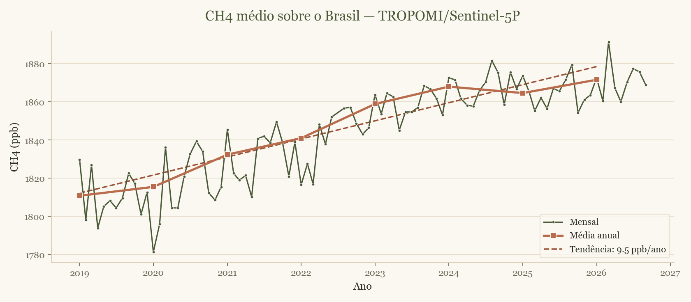

**Monthly** mean (`P1M`) of CH4 over Brazil. Unlike the daily series, it fits in
a **single request** for the whole period.

## Code

::: {.lang-python}
```python
import tropomi_ch4 as tch4
from tropomi_ch4 import plot

df = tch4.monthly(start="2019-01-01", end=None)   # None = up to current month
df.to_csv("serie_mensal_ch4_brasil.csv", index=False)

plot.plot_series(df, title="Monthly mean CH4 over Brazil — TROPOMI",
                 outfile="serie_mensal_ch4_brasil.png")
```
:::

::: {.lang-r}
```r
source("r/tropomi_ch4.R")

mensal <- ch4_mensal("2019-01-01")   # up to current month
write.csv(mensal, "serie_mensal_ch4_brasil.csv", row.names = FALSE)

plot(mensal$data, mensal$ch4_ppb, type = "o", pch = 20, col = "darkred",
     xlab = "Year", ylab = "CH4 (ppb)", main = "Monthly CH4 over Brazil — TROPOMI")
```
:::

{fig-align="center" width="100%"}

## Filtering weak months

::: {.lang-python}
```python
df_bom = df[df["n_validos"] > 200]
```
:::

::: {.lang-r}
```r
mensal_bom <- subset(mensal, n_validos > 200)
```
:::

## Daily vs. monthly

| | Daily | Monthly |
|---|---|---|
| Granularity | `P1D` | `P1M` |
| Requests | 1 per year | 1 total |
| Typical use | fine seasonality, events | trends, long series |

Notebook: [`notebooks/02_mensal.ipynb`](https://github.com/LudimiladeAzevedoBeltran/tropomi-ch4-brasil/blob/main/notebooks/02_mensal.ipynb).
